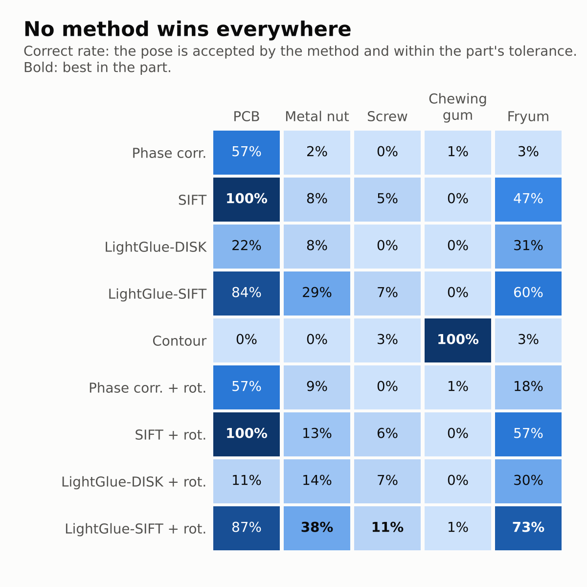
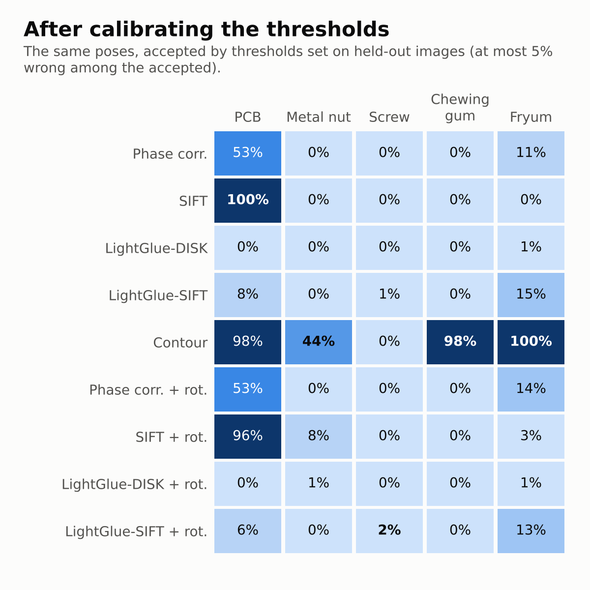

# inspection-align-bench

How well do image-alignment methods register a test image to a golden image on real inspection parts, how often do they accept
a wrong pose without warning, and does their own score know the difference? Five methods from four families, five parts from
two public datasets, hand-clicked ground truth, one command per part.



*Figures and tables in `report/` are produced by `python -m inspalign.report` from the result files; nothing is typed in by hand.*

## Results

* [`report/REPORT.md`](report/REPORT.md): every table behind the figures, the calibrated thresholds, and example pictures.
* [`report/carousel.pdf`](report/carousel.pdf): the figures as square pages.
* `results/<part>/` and `results/<part>_calib/`: the result files of the test and calibration runs (`results.csv`, `pairs.csv`,
  `manifest.json`, `thresholds.json`, `summary/`), computed with version 0.8.0 (the package was then called `alignbench`; 0.9.0
  renamed it and changed no evaluation code). The report can be rebuilt from them without the datasets:

  ```
  python -m inspalign.report results/pcb results/metal_nut results/screw results/chewing_gum results/fryum --out report \
         --labels "pcb=PCB,metal_nut=Metal nut,screw=Screw,chewing_gum=Chewing gum,fryum=Fryum"
  ```



## What is measured

* **Outcome of every attempt**: correct, silent wrong (a wrong pose the method accepted), right pose rejected, refused, no pose.
  "Correct" means within the part's tolerance, set from the annotation floor before any method ran (PROTOCOL.md).
* **Confidence**: how well each method's own score ranks its right poses above its wrong ones (AUROC, risk vs coverage).
* **Rotation search**: each method with and without a search over the part's distinct orientations.
* **Several goldens**: one, two or three reference images, with the method picking the golden by its own score.
* **Calibrated acceptance**: every method's threshold set on held-out images, next to its default.

## Quick start

```
pip install -r requirements.txt
python tests/selftest.py                       # must pass before any number is read
python tests/make_demo.py                      # a small synthetic landmark store -> data/demo
python evaluate.py --data data/demo --out results/demo
```

Then open `results/demo/run.log` and `results/demo/summary/SUMMARY.md`.

## Reproduce the benchmark

1. **Data.** Download VisA (CC BY 4.0) and MVTec AD (CC BY-NC-SA 4.0) from their authors. Per part take the first 43 good
   images by file name: the first three are the goldens, the other 40 the test images (PROTOCOL.md, section 2).
2. **Landmarks.** Open `tools/landmark_picker.html` in a browser, load a part's images, click the same named points on every
   image, save `landmarks.json`. Folder layout and file format: DATA_FORMAT.md.
3. **Run** each part with its frozen configuration:

   ```
   python evaluate.py --config configs/parts/pcb.yaml --out results/pcb
   ```
4. **Calibrate** the acceptance thresholds on 10 further images per part (DATA_FORMAT.md, section 6):

   ```
   python -m inspalign.calibrate store --test data/pcb --export calib_pcb.json --images calib_images/pcb --out data/pcb_calib
   python evaluate.py --config configs/parts/pcb.yaml --data data/pcb_calib --out results/pcb_calib
   python -m inspalign.calibrate fit results/pcb_calib
   ```
5. **Report** across parts (pictures only from the VisA parts):

   ```
   python -m inspalign.report results/pcb results/metal_nut results/screw results/chewing_gum results/fryum \
          --out report --labels pcb=PCB --show-images pcb,chewing_gum,fryum
   ```

The landmarks of the three VisA parts are in `annotations/<part>/landmarks.json` and `annotations/<part>_calib/landmarks.json`
(CC BY 4.0, made on VisA images; credit: Kai Xuan). To rerun a VisA part, put each `landmarks.json` in its data folder and copy
the listed images from VisA `pcb1`, `chewinggum` or `fryum` (`Data/Images/Normal`) into `images/` and the goldens into
`templates/Full/`. The MVTec AD landmarks are not published (the dataset's licence is non-commercial share-alike).

## The methods

All implement `align(test_bgr, golden_bgr, golden_mask) -> Result`; `Result.M` maps test-image pixels to golden pixels, and the
method accepts or rejects its pose by a threshold on its own decision score.

| method | family | pose model | how it works |
|---|---|---|---|
| `phase_correlation` | dense / global | translation | Hanning-windowed phase correlation of the whole images |
| `sift_ransac` | classical keypoints | similarity | OpenCV SIFT, ratio test 0.75, RANSAC similarity (5 px, >= 6 inliers) |
| `lightglue_disk` | learned matcher | similarity | DISK keypoints matched by LightGlue, then the same RANSAC fit |
| `lightglue_sift` | learned matcher | similarity | SIFT keypoints matched by LightGlue, then the same RANSAC fit |
| `contour_shape_match` | shape | similarity | edge-direction agreement over a pyramid search, then a sub-pixel least-squares fit |

`identity` (no alignment) is the reference line. `<method>+rot` runs a method inside a rotation search. The learned methods
need `torch`, `kornia` and `lightglue` (see requirements.txt); without them they are recorded as unavailable.

## Data and licences

* VisA: Zou et al., *SPot-the-Difference Self-Supervised Pre-training for Anomaly Detection and Segmentation*, ECCV 2022.
  CC BY 4.0: pictures may be shown with attribution.
* MVTec AD: Bergmann et al., *MVTec AD — A Comprehensive Real-World Dataset for Unsupervised Anomaly Detection*, CVPR 2019.
  CC BY-NC-SA 4.0: only numbers are published here; no MVTec image is redistributed.
* LightGlue (Lindenberger, Sarlin & Pollefeys, ICCV 2023) and its DISK and SIFT weights: Apache-2.0. SuperPoint is not used
  (non-commercial licence).
* Code: Apache License 2.0 (LICENSE, NOTICE). The datasets keep their own licences above. Pictures in `report/` are made from
  VisA images (CC BY 4.0, credited above); no MVTec AD image, and no picture made from one, is included.

## References

* Gower, J. C. (1975). Generalized Procrustes analysis. *Psychometrika* 40, 33–51.
* Dryden, I. L. & Mardia, K. V. (2016). *Statistical Shape Analysis, with Applications in R*, 2nd ed. Wiley.
* Steger, C. (2001). Similarity measures for occlusion, clutter, and illumination invariant object recognition. DAGM 2001.
* Brown, M., Szeliski, R. & Winder, S. (2005). Multi-image matching using multi-scale oriented patches. CVPR 2005.
