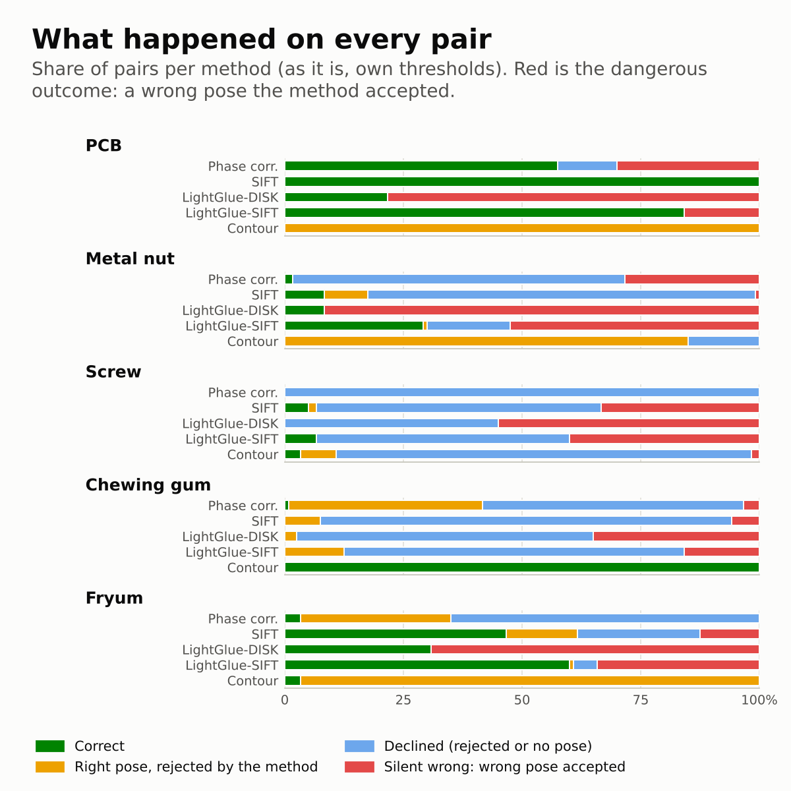
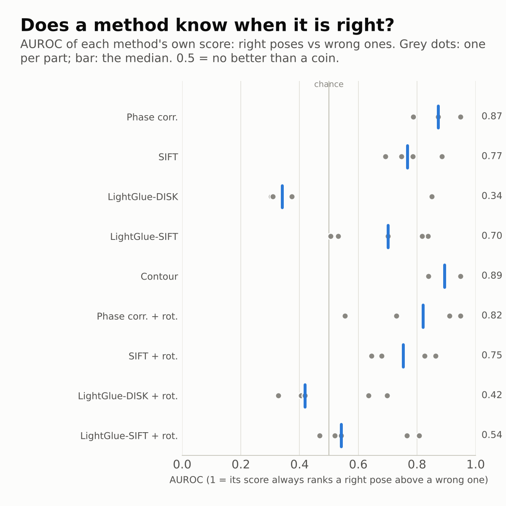
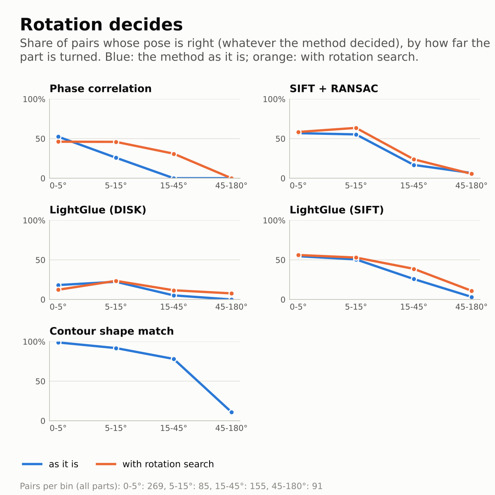
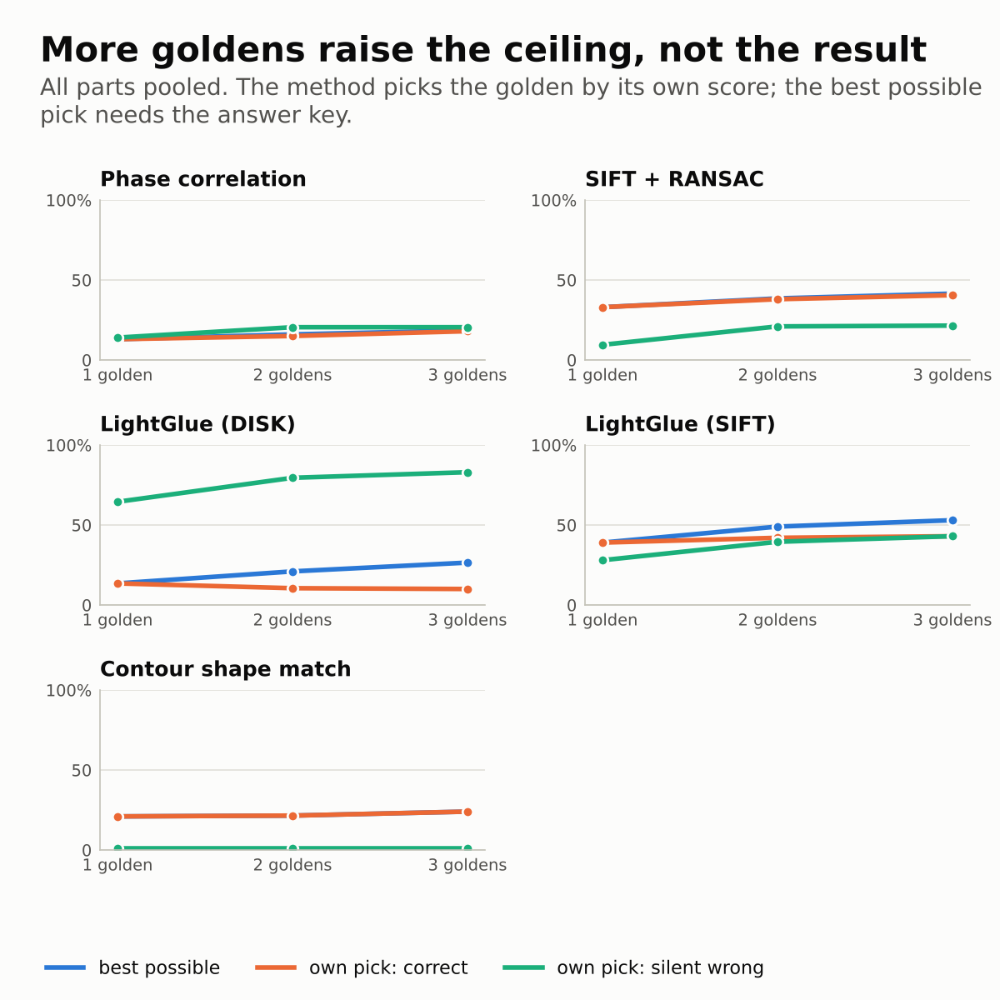
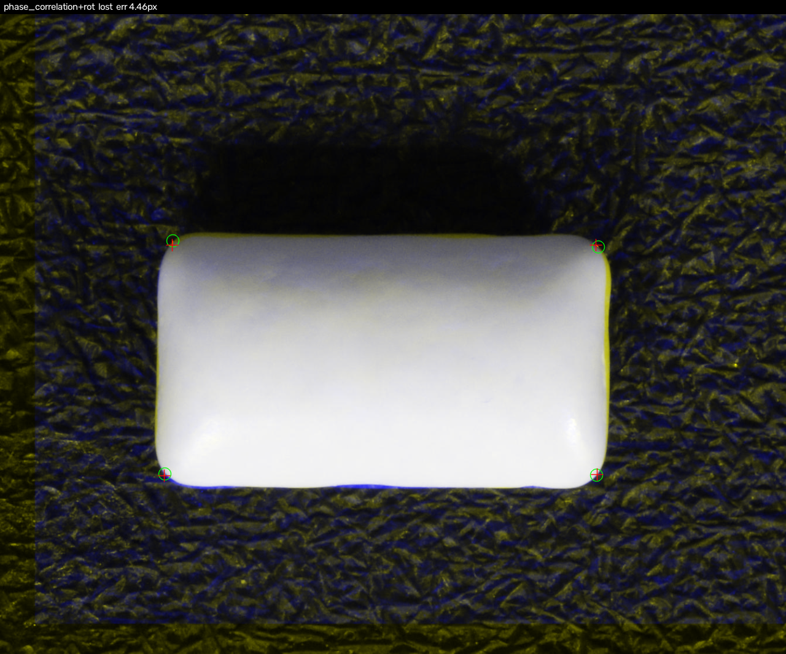
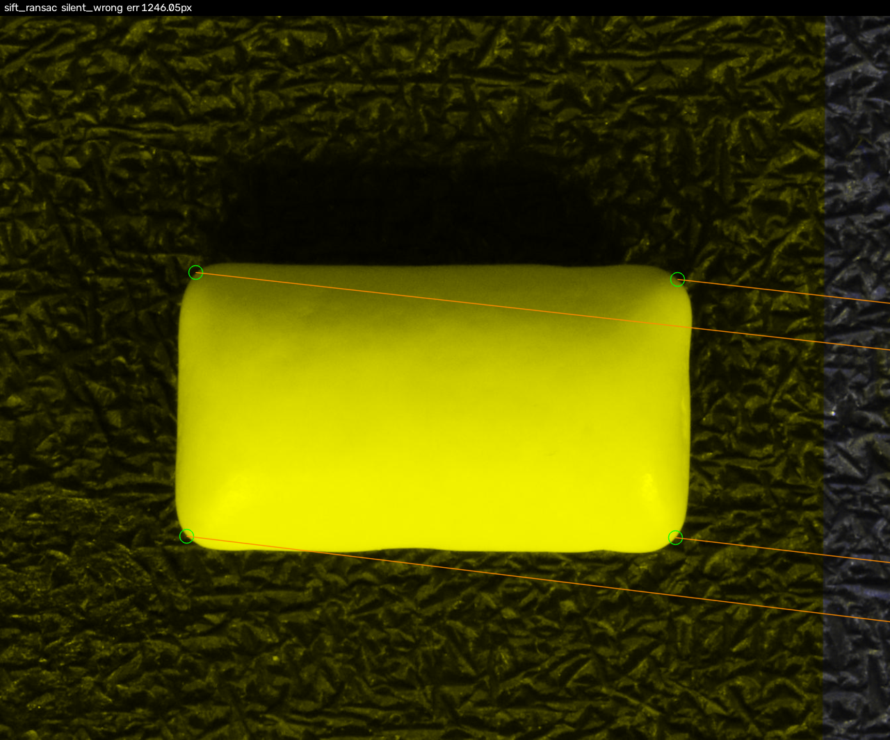
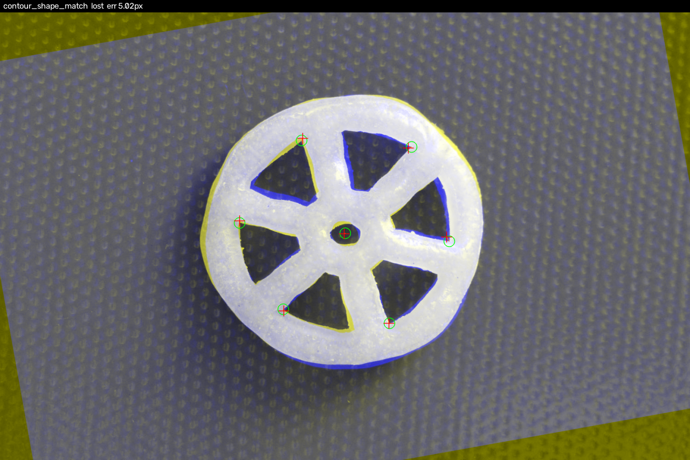
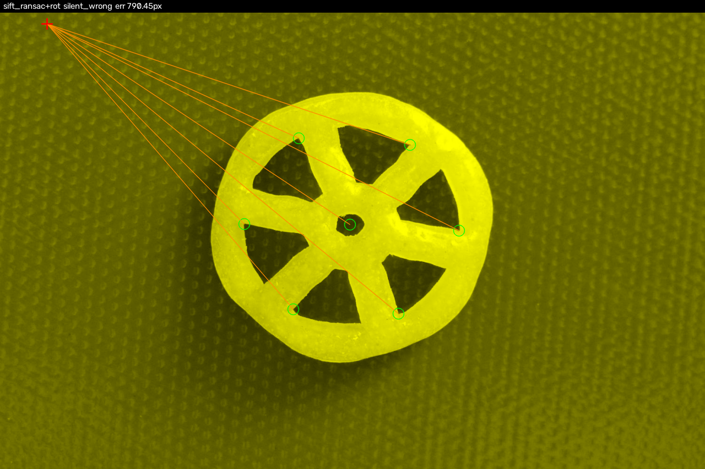
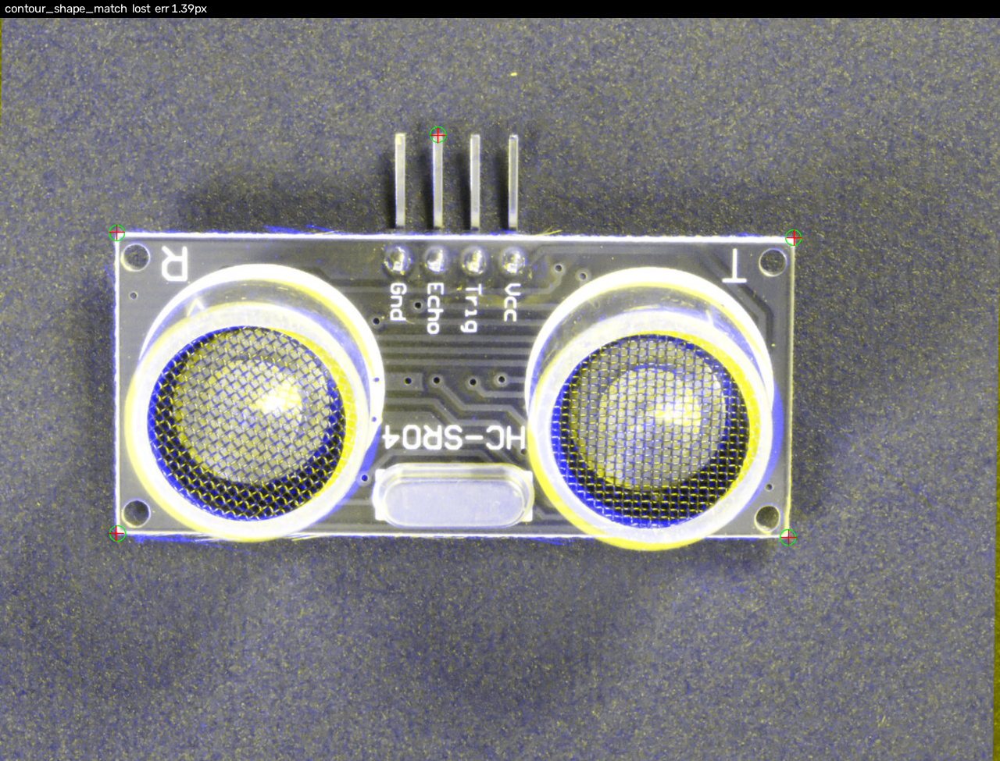
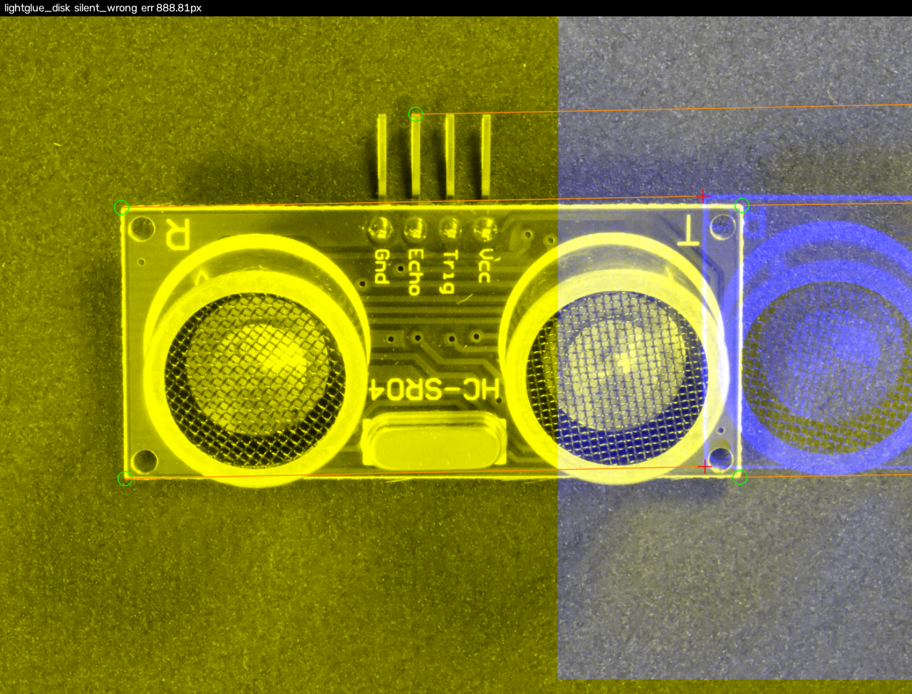

# Results

Parts: PCB, Metal nut, Screw, Chewing gum, Fryum. Pairs per part: PCB 120, Metal nut 120, Screw 120, Chewing gum 120, Fryum 120. Each part is judged with its own tolerance (2 x the 95th percentile of its annotation floor).

## Correct rate (%), the methods' own decisions

| method | PCB | Metal nut | Screw | Chewing gum | Fryum |
|---|---|---|---|---|---|
| Phase correlation | 57 | 2 | 0 | 1 | 3 |
| SIFT + RANSAC | 100 | 8 | 5 | 0 | 47 |
| LightGlue (DISK) | 22 | 8 | 0 | 0 | 31 |
| LightGlue (SIFT) | 84 | 29 | 7 | 0 | 60 |
| Contour shape match | 0 | 0 | 3 | 100 | 3 |
| Phase correlation + rotation search | 57 | 9 | 0 | 1 | 18 |
| SIFT + RANSAC + rotation search | 100 | 13 | 6 | 0 | 57 |
| LightGlue (DISK) + rotation search | 11 | 14 | 7 | 0 | 30 |
| LightGlue (SIFT) + rotation search | 87 | 38 | 11 | 1 | 73 |

## Correct rate (%), thresholds calibrated on held-out images

| method | PCB | Metal nut | Screw | Chewing gum | Fryum |
|---|---|---|---|---|---|
| Phase correlation | 53 | 0 | 0 | 0 | 11 |
| SIFT + RANSAC | 100 | 0 | 0 | 0 | 0 |
| LightGlue (DISK) | 0 | 0 | 0 | 0 | 1 |
| LightGlue (SIFT) | 8 | 0 | 1 | 0 | 15 |
| Contour shape match | 98 | 44 | 0 | 98 | 100 |
| Phase correlation + rotation search | 53 | 0 | 0 | 0 | 14 |
| SIFT + RANSAC + rotation search | 96 | 8 | 0 | 0 | 3 |
| LightGlue (DISK) + rotation search | 0 | 1 | 0 | 0 | 1 |
| LightGlue (SIFT) + rotation search | 6 | 0 | 2 | 0 | 13 |

## Calibrated thresholds

Fitted on held-out images (inspalign/calibrate.py). accepted: calibration pairs the threshold accepts; a threshold resting on fewer than 5 of them is marked.

| part | method | threshold | calibration_pairs | right_poses | accepted | note |
|---|---|---|---|---|---|---|
| PCB | Phase correlation | 0.199337 | 30 | 20 | 21 |  |
| PCB | SIFT + RANSAC | 103 | 30 | 29 | 30 |  |
| PCB | LightGlue (DISK) | accept none | 30 | 1 | 0 |  |
| PCB | LightGlue (SIFT) | 428 | 30 | 25 | 2 | rests on fewer than 5 accepted poses |
| PCB | Contour shape match | 0.223066 | 30 | 30 | 30 |  |
| PCB | Phase correlation + rotation search | 0.199337 | 30 | 20 | 21 |  |
| PCB | SIFT + RANSAC + rotation search | 127 | 30 | 29 | 30 |  |
| PCB | LightGlue (DISK) + rotation search | accept none | 30 | 0 | 0 |  |
| PCB | LightGlue (SIFT) + rotation search | 448 | 30 | 23 | 2 | rests on fewer than 5 accepted poses |
| Metal nut | Phase correlation | accept none | 30 | 0 | 0 |  |
| Metal nut | SIFT + RANSAC | accept none | 30 | 4 | 0 |  |
| Metal nut | LightGlue (DISK) | accept none | 30 | 2 | 0 |  |
| Metal nut | LightGlue (SIFT) | 195 | 30 | 6 | 1 | rests on fewer than 5 accepted poses |
| Metal nut | Contour shape match | 0.198145 | 30 | 26 | 11 |  |
| Metal nut | Phase correlation + rotation search | accept none | 30 | 4 | 0 |  |
| Metal nut | SIFT + RANSAC + rotation search | 7 | 30 | 8 | 2 | rests on fewer than 5 accepted poses |
| Metal nut | LightGlue (DISK) + rotation search | 180 | 30 | 3 | 1 | rests on fewer than 5 accepted poses |
| Metal nut | LightGlue (SIFT) + rotation search | 278 | 30 | 9 | 1 | rests on fewer than 5 accepted poses |
| Screw | Phase correlation | accept none | 30 | 0 | 0 |  |
| Screw | SIFT + RANSAC | accept none | 30 | 0 | 0 |  |
| Screw | LightGlue (DISK) | accept none | 30 | 0 | 0 |  |
| Screw | LightGlue (SIFT) | 287 | 30 | 3 | 1 | rests on fewer than 5 accepted poses |
| Screw | Contour shape match | accept none | 30 | 1 | 0 |  |
| Screw | Phase correlation + rotation search | accept none | 30 | 0 | 0 |  |
| Screw | SIFT + RANSAC + rotation search | accept none | 30 | 0 | 0 |  |
| Screw | LightGlue (DISK) + rotation search | accept none | 30 | 0 | 0 |  |
| Screw | LightGlue (SIFT) + rotation search | 384 | 30 | 3 | 1 | rests on fewer than 5 accepted poses |
| Chewing gum | Phase correlation | accept none | 30 | 9 | 0 |  |
| Chewing gum | SIFT + RANSAC | accept none | 30 | 1 | 0 |  |
| Chewing gum | LightGlue (DISK) | accept none | 30 | 0 | 0 |  |
| Chewing gum | LightGlue (SIFT) | accept none | 30 | 4 | 0 |  |
| Chewing gum | Contour shape match | 0.749854 | 30 | 30 | 30 |  |
| Chewing gum | Phase correlation + rotation search | accept none | 30 | 9 | 0 |  |
| Chewing gum | SIFT + RANSAC + rotation search | accept none | 30 | 0 | 0 |  |
| Chewing gum | LightGlue (DISK) + rotation search | accept none | 30 | 1 | 0 |  |
| Chewing gum | LightGlue (SIFT) + rotation search | accept none | 30 | 3 | 0 |  |
| Fryum | Phase correlation | 0.0722011 | 30 | 14 | 5 |  |
| Fryum | SIFT + RANSAC | accept none | 30 | 20 | 0 |  |
| Fryum | LightGlue (DISK) | 554 | 30 | 6 | 1 | rests on fewer than 5 accepted poses |
| Fryum | LightGlue (SIFT) | 86 | 30 | 21 | 5 |  |
| Fryum | Contour shape match | 0.206865 | 30 | 30 | 30 |  |
| Fryum | Phase correlation + rotation search | 0.105712 | 30 | 18 | 2 | rests on fewer than 5 accepted poses |
| Fryum | SIFT + RANSAC + rotation search | 14 | 30 | 18 | 1 | rests on fewer than 5 accepted poses |
| Fryum | LightGlue (DISK) + rotation search | 554 | 30 | 7 | 1 | rests on fewer than 5 accepted poses |
| Fryum | LightGlue (SIFT) + rotation search | 114 | 30 | 19 | 5 |  |

## Silent wrong (%): wrong poses the method accepted

| method | PCB | Metal nut | Screw | Chewing gum | Fryum |
|---|---|---|---|---|---|
| Phase correlation | 30 | 28 | 0 | 3 | 0 |
| SIFT + RANSAC | 0 | 1 | 33 | 6 | 12 |
| LightGlue (DISK) | 78 | 92 | 55 | 35 | 69 |
| LightGlue (SIFT) | 16 | 52 | 40 | 16 | 34 |
| Contour shape match | 0 | 0 | 2 | 0 | 0 |
| Phase correlation + rotation search | 31 | 47 | 19 | 3 | 1 |
| SIFT + RANSAC + rotation search | 0 | 2 | 48 | 10 | 21 |
| LightGlue (DISK) + rotation search | 89 | 86 | 90 | 39 | 70 |
| LightGlue (SIFT) + rotation search | 13 | 60 | 89 | 21 | 27 |

## AUROC of the method's own score (right vs wrong poses)

| method | PCB | Metal nut | Screw | Chewing gum | Fryum |
|---|---|---|---|---|---|
| Phase correlation | 0.95 |  |  | 0.87 | 0.79 |
| SIFT + RANSAC |  | 0.89 | 0.75 | 0.69 | 0.79 |
| LightGlue (DISK) | 0.30 | 0.85 |  | 0.31 | 0.37 |
| LightGlue (SIFT) | 0.53 | 0.84 | 0.82 | 0.51 | 0.70 |
| Contour shape match |  | 0.84 | 0.95 |  |  |
| Phase correlation + rotation search | 0.95 | 0.56 |  | 0.91 | 0.73 |
| SIFT + RANSAC + rotation search |  | 0.86 | 0.83 | 0.68 | 0.64 |
| LightGlue (DISK) + rotation search | 0.64 | 0.70 | 0.40 | 0.42 | 0.33 |
| LightGlue (SIFT) + rotation search | 0.52 | 0.77 | 0.81 | 0.47 | 0.54 |

## Right pose (%) by rotation of the part, all parts pooled

| method | 0-5 | 5-15 | 15-45 | 45-180 |
|---|---|---|---|---|
| Phase correlation | 52 | 26 | 0 | 0 |
| SIFT + RANSAC | 57 | 55 | 17 | 7 |
| LightGlue (DISK) | 18 | 22 | 5 | 0 |
| LightGlue (SIFT) | 55 | 51 | 26 | 3 |
| Contour shape match | 99 | 92 | 78 | 11 |
| Phase correlation + rotation search | 46 | 46 | 31 | 0 |
| SIFT + RANSAC + rotation search | 58 | 64 | 24 | 5 |
| LightGlue (DISK) + rotation search | 12 | 24 | 12 | 8 |
| LightGlue (SIFT) + rotation search | 56 | 53 | 39 | 11 |

## Several goldens, all parts pooled (%)

| method | k | best_possible | own_pick_correct | own_pick_silent_wrong |
|---|---|---|---|---|
| Phase correlation | 1 | 13 | 13 | 14 |
| Phase correlation | 2 | 16 | 15 | 20 |
| Phase correlation | 3 | 18 | 18 | 20 |
| SIFT + RANSAC | 1 | 33 | 33 | 10 |
| SIFT + RANSAC | 2 | 38 | 38 | 21 |
| SIFT + RANSAC | 3 | 42 | 40 | 22 |
| LightGlue (DISK) | 1 | 14 | 14 | 64 |
| LightGlue (DISK) | 2 | 21 | 10 | 80 |
| LightGlue (DISK) | 3 | 26 | 10 | 83 |
| LightGlue (SIFT) | 1 | 39 | 39 | 28 |
| LightGlue (SIFT) | 2 | 49 | 42 | 40 |
| LightGlue (SIFT) | 3 | 53 | 43 | 43 |
| Contour shape match | 1 | 21 | 21 | 1 |
| Contour shape match | 2 | 22 | 22 | 1 |
| Contour shape match | 3 | 24 | 24 | 1 |

## Median time per pair (ms)

| method | PCB | Metal nut | Screw | Chewing gum | Fryum |
|---|---|---|---|---|---|
| Phase correlation | 31 | 6 | 13 | 23 | 24 |
| SIFT + RANSAC | 2225 | 89 | 130 | 477 | 364 |
| LightGlue (DISK) | 1979 | 1485 | 2361 | 2144 | 1791 |
| LightGlue (SIFT) | 873 | 694 | 792 | 779 | 776 |
| Contour shape match | 5996 | 258 | 3884 | 1249 | 500 |
| Phase correlation + rotation search | 1905 | 87 | 825 | 580 | 267 |
| SIFT + RANSAC + rotation search | 56160 | 767 | 5036 | 7112 | 1995 |
| LightGlue (DISK) + rotation search | 49996 | 10446 | 56196 | 25672 | 7926 |
| LightGlue (SIFT) + rotation search | 23154 | 4728 | 20308 | 10383 | 3477 |

## Figures

## Example pictures

